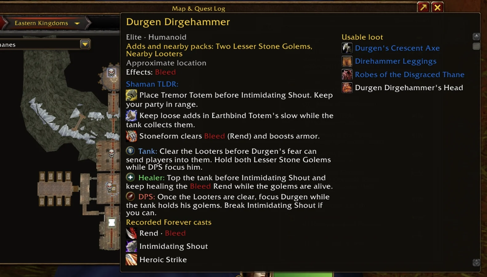
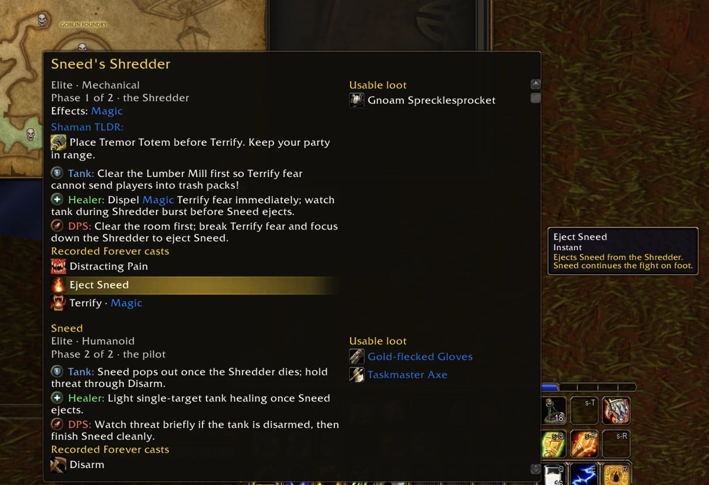
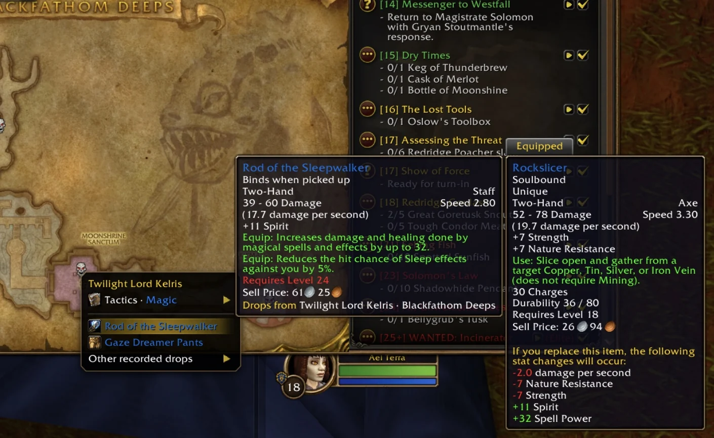
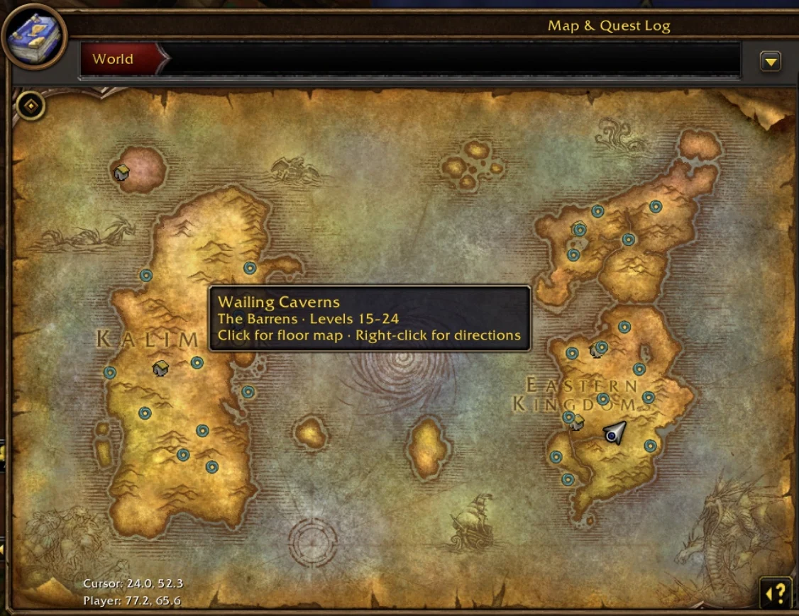
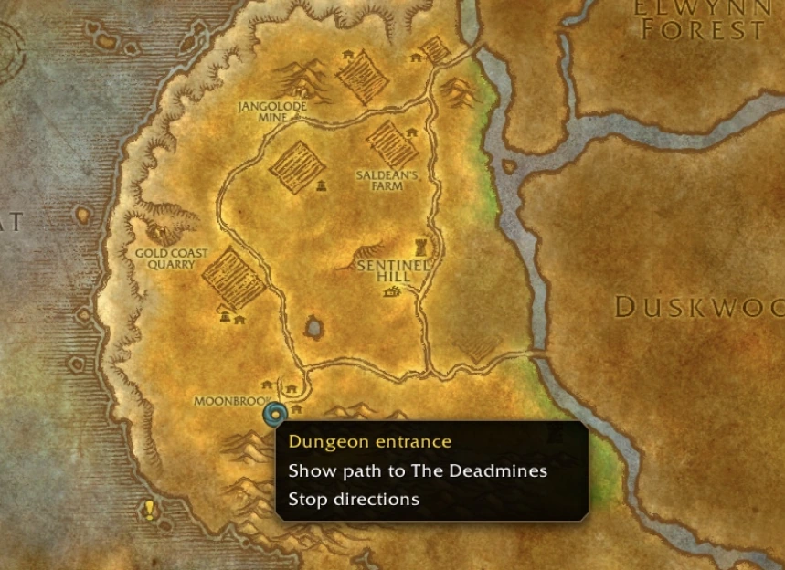
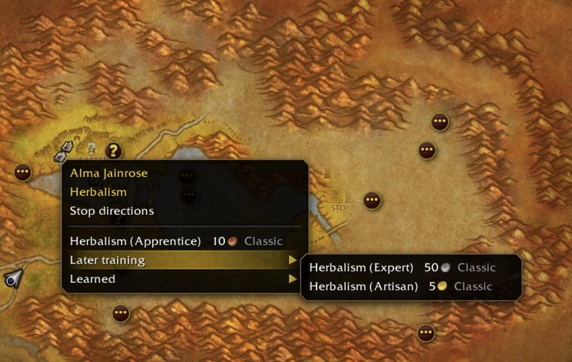
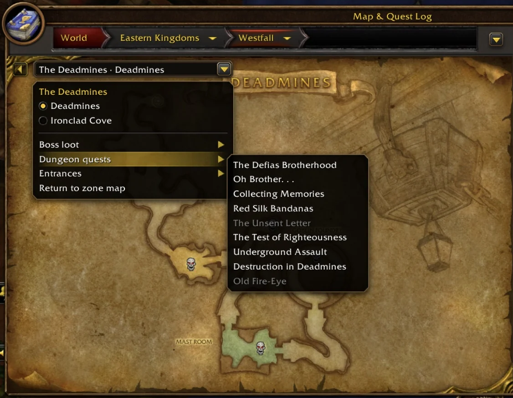

<div align="center">


# Aeternum

**Dungeon maps, boss tactics for your character, usable loot, trainers, quests, and minimap directions on the World of Warcraft: Forever map.**

[](https://github.com/0xAell/Aeternum/releases/latest)
[](https://www.curseforge.com/wow/addons/aeternum)
[](https://github.com/0xAell/Aeternum/releases/latest)
[](https://github.com/0xAell/Aeternum/actions/workflows/ci.yml)
[](LICENSE)

[Install](#install) · [Features](#features) · [Controls & Commands](#controls--commands) · [Player Guide](docs/map-guide.md) · [Data & Credits](DATA_SOURCES.md)

</div>

---

Press **M** and everything you need is already on the map. Aeternum adds dungeon floors, character-aware boss loot, offline trainer catalogues, quest pins, and minimap directions directly to Blizzard's world map. It uses native menus, tooltips, and map art, ships with its full database offline, and needs no setup or other addons.

Aeternum automatically detects your character’s **class, race, and learned professions** to tailor boss tips, usable loot, trainer pins, and quest availability.

[](docs/screenshots/forever-boss-guide.webp)

*Hover any boss skull, including WoW Forever dungeons like The Hall of Thanes, for detected class and racial counters, role tactics, recorded casts, and usable loot.*

## Features

### Dungeon floors, boss tactics and loot
Click any entrance on the Azeroth, continent, or zone map to browse all 34 dungeons and wings across 71 floors. Not sure where to go next? **Dungeons by level** lists every dungeon from the lowest level range to the highest, colored for your character the way the game colors quests. Inside an instance, pressing **M** opens your current floor automatically and shows your position wherever the client reports coordinates. The floor also follows boss fights, which helps where the game gives no room name.

[](docs/screenshots/boss-encounter.webp)

*Multi-phase encounters share one skull: hover to see both phases of Sneed's fight, class advice, and spell tooltips.*

- Hover a skull to open the encounter guide. It shows class counters like Tremor Totem for Sneed's Shredder, quick tactics for tanks, healers, and DPS, and color-coded effects. When the records identify them, the guide also shows the boss's creature type, rank, and adds. Recorded Forever casts and reference spells have separate labels. [Boss mechanics and sources](docs/boss-audit/mechanics.md)
- Tactics and usable loot appear side by side, with every encounter listed when bosses share a skull. Move into the guide to scroll, hover an item for its stats, or hover a class ability or boss cast for its spell tooltip. Loot uses your class, proficiencies, and professions, and recipes you already know drop off the list.
- Click a skull for the boss menu, with **Shift-click** to link an item in chat and **Ctrl-click** to preview it in the dressing room. Find bosses whose positions are unknown under **Boss loot** in the floor menu or by searching for their name.
- The loot list labels verified boss drops, other recorded drops, encounter rolls, and guide-listed items. The game’s item tooltips name drop sources for verified drops and encounter rolls.
- Check which **Dungeon keys** are in your bags from the floor menu. Defeated bosses dim as you clear the run.

[](docs/screenshots/boss-loot-comparison.webp)

*Click a boss skull for its tactics menu, usable loot, live Equipped comparisons, and drop-source tooltips.*

### Entrances and minimap directions
Hover over a zone to see its recommended levels, on the Azeroth, continent, and zone maps, including unexplored terrain.

All 41 outdoor entrances appear on world, continent, and zone maps, including multi-door dungeons like Dire Maul, Uldaman, and Blackrock Mountain.

- Right-click any entrance (or click a trainer or quest pin) for a minimap bearing to the door.
- Ten trickier entrances (The Deadmines, Ragefire Chasm, all four Scarlet Monastery wings, Alcaz Prison, Blackmaw Hold, Krol'dok Stronghold, and Shaper's Terrace) include mapped approach waypoints.
- Directions survive `/reload`, pause automatically on another continent or inside an unrelated instance, and clear once you arrive.

| World map dungeon pins | Minimap directions |
| :---: | :---: |
| [](docs/screenshots/world-entrances.webp) | [](docs/screenshots/dungeon-entrance.webp) |
| *Every dungeon portal on the world map with level ranges.* | *Right-click Moonbrook to start minimap directions.* |

### Offline trainer catalogues
Trainers filter automatically to your class, faction, learned professions, and eligible weapon skills. Toggle **Other classes and professions** in Blizzard's map tracking menu whenever you want to see everyone.

- Click a trainer to check spells, recipes, ranks, requirements, and prices before making the trip, sorted into what you can train now, **Later training**, and **Learned**.
- 522 of 561 trainers have offline catalogues ready before your first visit, and talking to any trainer updates their lessons and prices for your character.

[](docs/screenshots/trainer-catalogue.webp)

*Check a trainer's recipes, ranks, prices, and full item tooltips on the map before making the trip.*

### Quests and live objectives
Exclamation marks show quests you can pick up, and question marks turn gold when you're ready to hand in, factoring in your level, race, class, profession rank, quest chains, and live quest log.

- Open **Dungeon quests** from any floor menu to locate the quest giver before accepting or the turn-in afterward.
- For your focused (or first watched) quest, Aeternum marks recorded locations for unfinished objectives whenever Blizzard doesn't already place a marker.

[](docs/screenshots/dungeon-quests.webp)

*Open **Dungeon quests** from any floor menu to check every quest for the instance and locate its giver or turn-in.*

## Install

### CurseForge (recommended)
Install directly from the **[CurseForge project page](https://www.curseforge.com/wow/addons/aeternum)** or search for **Aeternum** in the CurseForge app.

### Manual install from GitHub
1. Download `Aeternum-<version>.zip` from the **[latest release](https://github.com/0xAell/Aeternum/releases/latest)** under **Assets**.
2. Extract it into your WoW Forever `AddOns` folder so the path looks like:
   ```text
   World of Warcraft/_forever_/Interface/AddOns/Aeternum/Aeternum.toc
   ```
3. Launch the game (or run `/reload` if you're already logged in) and press **M**.

> [!TIP]
> **Quick check in game:** Open Westfall, click **The Deadmines** near Moonbrook, and hover a boss skull to see its tactics and loot. Right-click the entrance for minimap directions down through Moonbrook.

## Controls & Commands

### On the map

| Action | Result |
| --- | --- |
| **Left-click** a dungeon entrance | Open its floor map and boss pins |
| **Right-click** a dungeon entrance | Start or stop minimap directions to a wing or door |
| **Hover** a boss skull | Read tactics, spells, adds, and usable loot for every encounter on that pin |
| **Scroll** inside the boss guide | Read longer encounter and loot lists |
| **Left-click** a boss skull | Open the boss menu for item links, previews, and encounter selection |
| **Left-click** a trainer or quest pin | Browse lessons and prices, track a quest, or start directions |
| **Scroll / drag** on a dungeon floor | Zoom in and pan around the floor |
| **Back** button or **Right-click** empty floor | Return to the outdoor zone map (**Escape** closes the map) |
| **Map tracking menu** (magnifying glass) | Open **Dungeons by level**, or toggle entrances, trainers, low-level quests, or all quest locations |
| **Addon compartment** (minimap) → **Aeternum** | Open the map with **Dungeons by level** |

### Slash commands

| Command | What it does |
| --- | --- |
| `/aeternum` | Open the world map |
| `/aeternum <search>` | Search dungeons, bosses, or usable drops in any word order (e.g. `/aeternum herod scarlet`) |
| `/aeternum dungeons [name]` | List every dungeon by level, or jump straight to a matching boss or item (e.g. `/aeternum dungeons Cruel Barb`) |
| `/aeternum stop` | Stop active minimap directions |
| `/aeternum reset` | Reset Aeternum's map filters to defaults |
| `/aeternum help` | Show available commands in chat |

For the full walkthrough of map filters, floor tracking, and tooltip indicators, see the **[Player Guide](docs/map-guide.md)**.

## Database Coverage

| Area | Coverage | Audit & details |
| --- | --- | --- |
| **Dungeons & floors** | 34 dungeons & wings · 71 floors · 41 outdoor entrances (10 with approach waypoints) | [Player Guide](docs/map-guide.md) |
| **Bosses & loot** | 302 boss & encounter entries · 277 floor pins · 1,428 audited items (1,420 with verified requirements) | [Boss & Loot Audit](docs/boss-audit/README.md) |
| **Trainers** | 561 trainers (562 map locations, 8 weapon masters) · 522 offline catalogues · 1,743 spells & recipes | [Trainer Coverage](docs/trainer-data/README.md) |
| **Quests** | 5,323 quests · 11,100 start & turn-in pins · 5,207 objective sites across 2,097 quests | [Data Sources](DATA_SOURCES.md) |

## AI Disclosure

AI tools helped brainstorm features and explore design ideas and visual references. They also helped generate and revise Lua code, draft placeholder copy, encounter notes, and documentation, and edit promotional materials. OpenAI ImageGen generated the arch logo used as the project icon. The gameplay screenshots and footage were captured in WoW Forever.

## What Aeternum Adds to WoW Forever

Aeternum brings a WoW Forever dungeon guide into Blizzard’s world map. Hovering a boss skull opens a guide that combines role tactics, class and racial counters, and loot filtered for your character. For example, the Witherfang guide explains how a Dwarf Shaman can use Stoneform to clear Leech Poison. Hover either spell to read its tooltip. The same map offers minimap directions to entrances, dungeon quests, and trainer catalogues with lessons, recipes, and prices. The addon uses Blizzard’s map controls and tooltips, and the game data ships with the addon for offline use.

## Feedback & Contributing

Spotted a misplaced boss pin, a missing drop, or an outdated trainer price? **[Open an issue](https://github.com/0xAell/Aeternum/issues)** with the dungeon, floor, and NPC or item name. An in-game screenshot always helps.

To contribute code or rebuild the bundled datasets locally, see **[CONTRIBUTING.md](CONTRIBUTING.md)** for the `luacheck`, LuaJIT test suite, data verification, and packaging commands.

---

<div align="center">

[Data Sources & Credits](DATA_SOURCES.md) · [Contributing](CONTRIBUTING.md) · [GPL-3.0 License](LICENSE)

<sub>README by Neon 4</sub>

</div>
